# Architecture & Convergence Design

Theseus solves a specific failure mode of legacy web migrations: rewrites look finished visually while silently breaking undocumented business rules (rounding order, promo stacking guards, whitespace handling, minimum thresholds).



## The Problem

Legacy migrations usually rely on one of two brittle strategies:

1. **Screenshot / pixel diffs:** Break the instant you replace a 2012 HTML table layout with a modern responsive UI. They punish intentional redesigns and cannot read invisible state transitions.
2. **Hand-written E2E assertions:** Require engineers to rediscover and encode every undocumented edge case from scratch—meaning the exact bugs you forgot to specify ship to production.

## The Approach

Theseus flips the model: **the running legacy application is the executable specification.**

1. **Baseline (`kane-cli run --agent --headless`):** Plain-English user journeys run in real headless Chrome against the legacy URL. Kane CLI extracts declared `store as` values, records console/HAR logs, captures annotated screenshots inside `.evidence` zips, and validates packs via `kane-cli evidence validate --profile L1`.
2. **Verify & Diff (`src/core/diff.ts`):** The identical plain-English journeys run against the modern rewrite. Theseus compares six drift classes:
   - `value_mismatch` (whitespace-normalized text or `numericTolerance` numeric delta)
   - `missing_key` (strictly enforced on every declared `storeKeys` entry)
   - `status` (flow execution status, with a guard that ignores benign legacy `--final-validation` prose nitpicks when legacy captured all declared `storeKeys` and modern passed)
   - `new_console_error` and `new_network_error` (only errors absent from the legacy baseline)
   - `kane_bug_detected` (new findings reported by Kane CLI's `--bug-detection continue` engine)
3. **LLM Key Canonicalization:** Browser LLM agents occasionally emit numbered duplicate keys (such as `promo_error_2` alongside `promo_error`). `canonicalizeStoredValues()` resolves numbered aliases back to their declared base key so non-deterministic naming cannot cause false `STUCK` verdicts while preserving strict missing-key enforcement.
4. **Closed-Loop Convergence (`src/core/converge.ts`):**
   - Builds a structured Markdown drift report containing expected vs. actual tables plus Chrome console/network errors and sends it to `claude -p` (or any `--agent-cmd`).
   - Takes `git diff HEAD -- .` and `git status --porcelain -uall -- .` snapshots scoped to `repoPath` before and after the agent runs. If the agent edits 0 files or produces an identical SHA-256 drift fingerprint across iterations, the loop halts cleanly with `STUCK`.
   - **Targeted re-verify + Mandatory Hydra regression pass:** Re-runs only failing flows first to save browser credits. Once all flows appear equivalent, Theseus forces a full regression pass across the entire suite from scratch. If fixing drift A broke flow B, the loop catches the Hydra regression and continues patching.
5. **Sealing & Signing (`src/kane/packs.ts`, `src/report/signer.ts`, `src/report/html.ts`):**
   - Runs `kane-cli evidence merge` to combine all legacy and modern `.evidence` packs into a single `.theseus/theseus-certificate.evidence` archive.
   - Computes a canonical recursive key-sorted SHA-256 digest over config, diffs, git commit SHA, and verdict.
   - Emits a zero-dependency, self-contained HTML certificate (`.theseus/report.html`) with inline base64 Chrome screenshots and per-iteration git diffs.

## Cross-Platform Process Spawning (`src/utils/spawn.ts`)

On Windows, npm/pnpm install `kane-cli` and `claude` as `.cmd` shims, which `child_process.spawn(..., { shell: false })` cannot execute (`ENOENT`), while `shell: true` corrupts multi-line prompts and quotes via `cmd.exe`.

`spawnResolved()` eliminates both failure modes without hardcoding `%APPDATA%`:
- Calls `where.exe` on `win32` (cached per binary).
- Prefers native `.exe` executables directly when present.
- Unwraps `.cmd` shims (`parseWindowsCmdShim`) to spawn either `node <target.cjs>` or `<target.exe>` directly with `shell: false`.
- Pipes multi-line agent prompts to `claude -p` over `stdin` instead of command-line arguments.

## Trade-offs

| Decision | What we gained | What we gave up |
|---|---|---|
| Behavioral `store as` diffs over pixel diffs | Full visual redesign freedom with zero CSS false positives | Layout-only regressions (e.g. misaligned padding) are intentionally out of scope |
| Targeted re-verify before full regression pass | Cuts Kane CLI credit spend on multi-iteration fixes | Final `EQUIVALENT` verdict still pays one full suite pass to prove zero Hydra regressions |
| Single-file self-contained HTML certificate | Offline-shareable PR/audit artifact with zero hosted backend | Larger HTML size (~1.3 MB) due to embedded base64 Chrome screenshots |
| Pluggable `--agent-cmd` subprocess interface | Works with Claude Code, OpenCode, Gemini CLI, Ollama, or custom scripts | Agent progress output is captured per iteration rather than streamed token-by-token |

---

## How to Run with Custom Coding Agents

Run `theseus converge` or `theseus demo` with any CLI coding agent that accepts a prompt argument or stdin.

### Prerequisites

- Node.js `>= 22`
- Kane CLI installed and logged in (`npm install -g @testmuai/kane-cli && kane-cli login`)
- One authenticated coding agent CLI

### Steps

1. **Claude Code (default — no flag needed):**
   ```bash
   node dist/cli.js demo --suite shop
   ```
2. **OpenCode (free tier via standalone mode):**
   ```bash
   node dist/cli.js demo --suite shop --agent-cmd "opencode run --standalone --auto {{prompt}}"
   ```
3. **Gemini CLI (free Google login tier):**
   ```bash
   node dist/cli.js demo --suite shop --agent-cmd "gemini -y -p {{prompt}}"
   ```

### Verification

Confirm exit code `0` and open `.theseus/report.html` to verify every flow shows `PASS`, the per-iteration git diff is non-empty, and a SHA-256 digest is printed.

### Troubleshooting

- **`Setup error: Kane CLI setup/auth error` (exit `2`):** Run `kane-cli whoami` and re-authenticate with `kane-cli login`.
- **`Stuck at iteration 1: agent changed 0 files` (exit `1`):** Confirm your agent CLI works standalone (`claude -p "reply ok"` or `opencode run --standalone --auto "reply ok"`). Theseus prints the agent's exit code and first stderr line directly in the terminal.
- **Windows `ENOENT` on custom `--agent-cmd`:** Use the default `claude` runner (handled automatically by `spawnResolved`) or ensure the custom binary is on `PATH`.
- **Windows `esbuild.exe ENOENT` with `pnpm` 10+:** pnpm 10 blocks `esbuild` postinstall scripts by default; run `npm install && npm run build` instead.

## Related

- [CLI & Configuration Reference](cli-reference.md) — full command flags, Zod schema, and exit codes.
- [README](../README.md) — quickstart and benchmark suites.
